# Stage Rotation — Staff Manual

**Sugar Shack · Lake Geneva, WI · for version 1.8.1**

Stage Rotation runs the stage rotation, the dance counts, champagne and house fees. This manual is for everyone who uses it. You don't have to read all of it: **find your job below** and read that part.

| Your job | Read this |
|---|---|
| DJ | [The basics](#the-basics) and [For the DJ](#for-the-dj) |
| House Mom | [The basics](#the-basics), [Signing in](#signing-in-on-an-ipad-or-iphone), [For the House Mom](#for-the-house-mom) |
| Dance Counter | [The basics](#the-basics), [Signing in](#signing-in-on-an-ipad-or-iphone), [For Dance Counters](#for-dance-counters) |
| Floor Host | [The basics](#the-basics), [Signing in](#signing-in-on-an-ipad-or-iphone), [For Floor Hosts](#for-floor-hosts) |
| Manager | Everything above, then [For Managers](#for-managers) and [How the money works](#how-the-money-works) |
| Owner / Admin | All of it, especially [For the Admin](#for-the-admin) |

Something not working? Go to [Something's wrong](#somethings-wrong).

---

## The basics

### The three screens

- **The DJ screen** is on the computer in the DJ booth. The rotation lives there. If that computer is off, nothing works.
- **The dressing-room TV** shows who's on stage, who's on deck and who's coming up. Nobody touches it.
- **iPads and iPhones** are for the House Mom, Dance Counters, Floor Hosts and Managers. Each person signs in with their own PIN.

Everything changes on every screen at the same time. When someone takes a girl off on an iPad, the DJ screen shows it right away.

**Which version is running?** Every screen shows it in small grey text: next to **🔒 Manager / Admin** on the DJ screen, after the date at the top of an iPad or iPhone (and under the PIN pad), and in the bottom corner of the dressing-room TV.

### Words we use

| Word | What it means |
|---|---|
| **Rotation** | The order the girls go up on stage. |
| **MAIN, DIAMOND, VIP** | The three stages. DIAMOND and VIP are the poles. With the poles on, a girl goes MAIN, then DIAMOND, then VIP. |
| **ON STAGE** | Dancing now. |
| **ON DECK** | Up next. |
| **Set** | A girl's turn on stage: **2 songs**, about 3 minutes each. |
| **Launch song** | The song that starts a special or a feature (the girls go sell 2 FOR 1s, or the customer gets on stage). |
| **NEXT** | The DJ presses NEXT when the set is over. Everyone moves up one. |
| **Off rotation** | Not going up for now. Why: **OFF** (break), **CHAMPAGNE**, **DOING 5** (VIP suite) or **WENT HOME** (done for the night). She keeps her spot until she comes back. |
| **BACK ON ROTATION** | She goes back to her spot. |
| **Feature** | Bachelor, Birthday or Stage dance. It gets its own turn on MAIN. |
| **Special** | 2 FOR 1, T-shirt or Hat feature, on a girl's turn. The poles go dark for that turn. |
| **Audition** | A new girl dances one set on MAIN, then she's gone from the list. |

Names are always in CAPITAL LETTERS.

---

## Signing in on an iPad or iPhone

1. Open Safari and go to the address the manager gives you. It looks like `http://192.168.1.50:8787/ipad` (iPhone: `/phone` at the end).
   Tip: tap **Share → Add to Home Screen**, and from then on it opens like an app.
2. Type **your own PIN** and press **OK**. Never use somebody else's PIN: the history shows who did what.

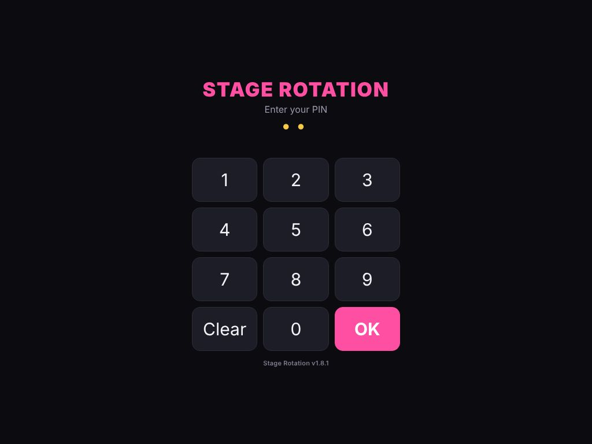

3. If you have more than one job (for example Floor Host and DJ), it asks which one you're doing tonight. Tap it.

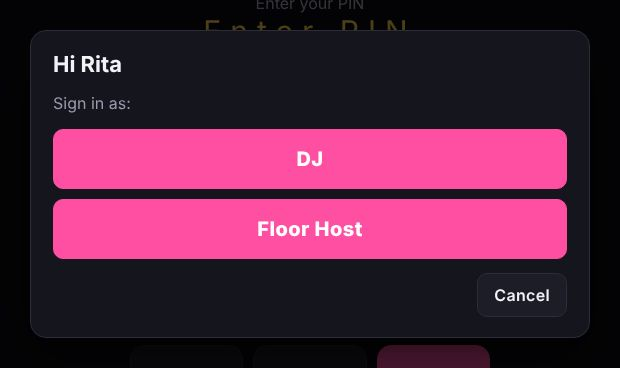

The buttons at the top:

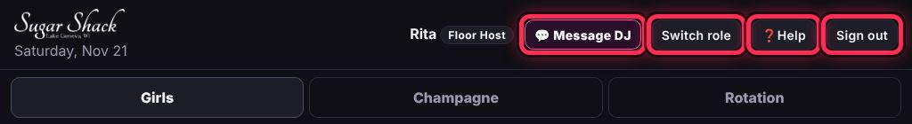

- **💬 Message DJ**: send the DJ a message. See [Messages to the DJ](#messages-to-the-dj).
- **My name & PIN** (**👤 Me** on an iPhone): change your own name or PIN. To change your PIN you need your current one.
- **Switch role**: change to your other job (only if you have two).
- **❓ Help**: opens this manual at your part.
- **Sign out**: when you're done, or before handing the iPad to someone else.

What you can see and do depends on your job, and the owner can change it (see [Permissions](#permissions)). If a button in this manual isn't on your iPad, you don't have it.

**Red bar saying "Reconnecting…"?** The iPad lost the connection (usually because it was locked). It catches up by itself in a few seconds. You can tap **Tap to reconnect**.

---

## For the DJ

The DJ screen has a **❓ HELP** button at the top. It opens a picture guide right on the screen, and NEXT still works while it's open. This part of the manual is the same guide.

### What's on the screen

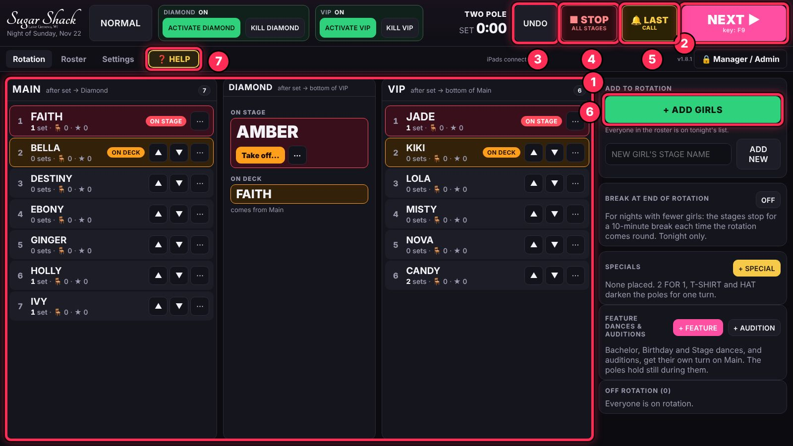

1. **The stages**: MAIN, DIAMOND and VIP. The girl at the top with **ON STAGE** is dancing now. **ON DECK** is next.
2. **NEXT ▶** moves everybody up when the set is over.
3. **UNDO** takes back the last thing you did.
4. **■ STOP** stops all stages for a break.
5. **🔔 LAST CALL** for the end of the night.
6. **+ ADD GIRLS** when girls get here.
7. **❓ HELP** opens the picture guide.

### Start the night

1. Press **+ ADD GIRLS**.
2. Tap each girl who is here, **in the order they go up**. A number shows the order. Tapped the wrong one? Tap her again.
3. A girl who isn't in the list? Type her name and press **+ Add to list**.
4. Press **Add**.

5. Turn on the poles you're using tonight: **ACTIVATE DIAMOND**, **ACTIVATE VIP**. No poles? Leave it on **NORMAL**.
6. Press **START ▶**.

### NEXT (every set)

**How long is a set?** A song is about 3 minutes.

- **A girl**: 2 songs.
- **A special** (2 FOR 1, T-shirt, Hat): the launch song first (the girls go sell 2 FOR 1s), then 3 songs on stage: 2 songs of 2 FOR 1 and a buffer song so the girls can get back.
- **A feature** (Bachelor, Birthday, Stage dance): the feature launch song while the customer gets on stage, 2 songs with the girls, then a launch song to clear the stage.
- **Start of the night**: the launch song, then the first girl. **The last 2 FOR 1 of the night**: 2 songs.
- Most DJs use the club's launch song; some use their own.

When her set is over, press **NEXT ▶**. The foot pedal (or the key under NEXT, like **F9**) does the same thing, even when the music program is in front. A second press within a few seconds doesn't count.

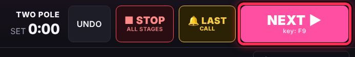

**Song count.** If the Admin turned it on, the set timer says which song it is (**SONG 1 OF 2**, **LAUNCH**, **2 FOR 1 · SONG 1 OF 2**, **BUFFER**…). When the set should be over it says **SET OVER · press NEXT** and NEXT glows.

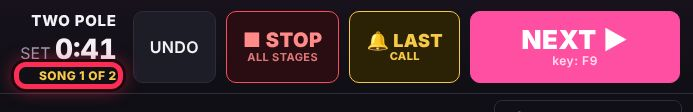

### Oops! UNDO

Press **UNDO**. It tells you what it will take back; press **UNDO** again to say yes. Press it again to go back another step.

### A girl comes off the rotation

Press the **⋯** next to her name, then why she's coming off:

- **OFF**: a break.
- **CHAMPAGNE**: a form opens (see [Champagne](#champagne)).
- **DOING 5**: a VIP suite. It's added to her count by itself.
- **WENT HOME**: done for the night.

The same menu has **⚠ Notes** (restrictions like **NO VIP**, see [Notes](#notes-and-going-home-early)) and **🏠 Wants to go home early** (she asked to leave early).

She keeps her spot and everybody else moves up. To put her back, press **BACK ON ROTATION** next to her name under **OFF ROTATION** (right side).

### Take a girl off a pole

She has to come down from DIAMOND or VIP in the middle of her song? Press **Take off…** under her name on the pole and pick why. The pole stays dark until NEXT, then the next girl goes up.

### Move a girl

**▲** moves her up one spot, **▼** down one spot. **⋯** has **To bottom** and moving her to the other line. You can also drag her name with the mouse. She keeps her new spot for the rest of the night.

### A girl shows up late

Press **+ ADD GIRLS**, tap her, press **Add**. Brand-new girl? Type her name in the box on the right and press **ADD NEW**. She goes in at the end of tonight's rotation.

### Champagne

1. **⋯** next to her name, then **CHAMPAGNE**.
2. Pick how long (30 minutes up to 6 hours).
3. The price fills in by itself. If she sold it for more, type what she sold it for. It can't be less than the base price.
4. Tap **Cash** or **Funny money**. Tapping a room is optional.
5. Press **Start timer**.

Not sure of the details? Press **Cancel**. She still comes off and a 30-minute timer starts. A manager, dance counter or floor host can fix the details on their iPad. (The DJ can't change a champagne once it's started.)

### Audition

On the right, press **+ AUDITION**, type her name, and pick **NEXT UP** (right after the girl on stage), **END OF THE ROTATION**, or pick the spot under **Or pick the spot** (before any girl) and press **Put her there**. To move her later, press **Edit** next to her audition (or ✎ in the list) and change **Where in the rotation**. She dances one set on MAIN, then she's gone. She isn't added to the roster and has no counts or fees.

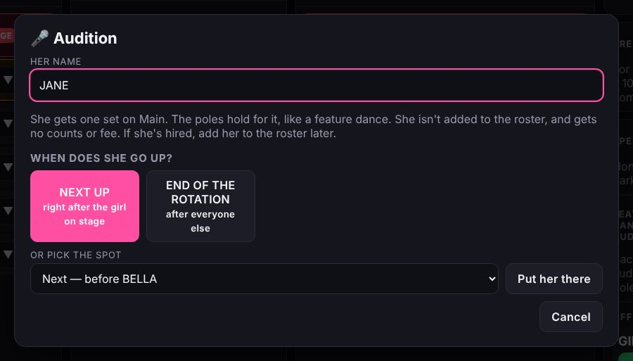

### Bachelor, birthday, 2 FOR 1

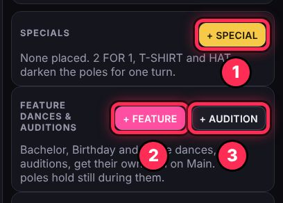

1. **+ SPECIAL**: tap 2 FOR 1, T-SHIRT or HAT, pick which girl's turn it goes on, press **Save**. When it comes up: the launch song, then her 3 songs (2 of 2 FOR 1, then a buffer). The poles go dark for it.
2. **+ FEATURE**: Bachelor, Birthday or Stage dance. Type the customer's name, tap the girls, pick where it goes. It gets its own turn on MAIN: the feature launch song, 2 songs, then a launch song to clear the stage.
3. **+ AUDITION**: see above.

### Break (STOP)

Press **■ STOP**, then **■ STOP ALL STAGES**. Everybody stays where she is and the screens say BREAK. Press **RESUME ▶** to start again with the same girls.

### Last call

Press **🔔 LAST CALL** and pick **LAST CALL NOW** (after the girl on stage), **At a time** (like 2:00 AM), or **At a spot** (tap the girl: she and the girl after her are the last two). When it's time, LAST CALL flashes everywhere: announce it. Keep pressing NEXT: the last 2 girls, then a 2 FOR 1 with everybody, then the night is over.

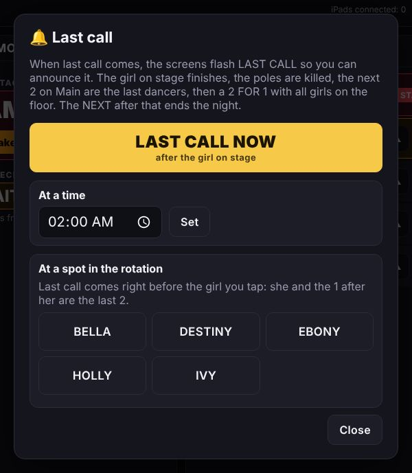

### A message is flashing

**MESSAGE FROM …**: read it and press **GOT IT** (their iPad shows that you saw it). To answer, press **REPLY**, type and send.

**ROTATION CHANGED**: someone on an iPad changed the rotation. Her name is outlined. Read it and press **GOT IT**.

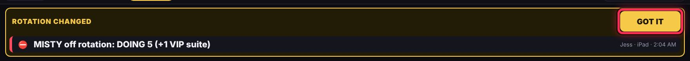

### The DJ on an iPad or iPhone

Sign in with your PIN as DJ. It opens on the **Rotation** tab with big **NEXT** and **UNDO** buttons, and you can move girls with ▲ ▼, **NEXT UP** and ⤓ (to the bottom). If the Admin allows it, you also get the poles and STOP there. Messages to the DJ show up on your iPad too.

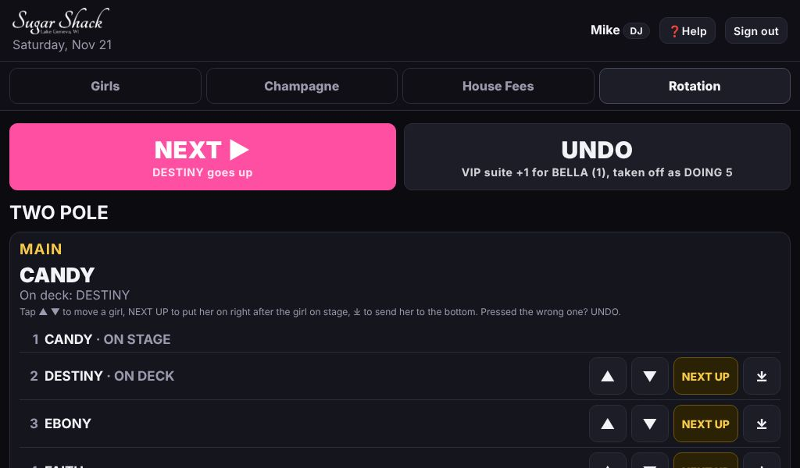

---

## For the House Mom

You sign in on an iPad as **House Mom**. You see the girls but not the money.

- **A girl gets here**: tap **+ ADD GIRLS**, tap her (and anyone else who just got here, in the order they go up), then **Add**. A girl who isn't in the list: type her name, **+ Add to list**.
- **Arrival time**: tap **Arrived?** next to her name (or the time, to fix it).
- **She's taking a break, going home, etc.**: **Take off…** then OFF, CHAMPAGNE, DOING 5 or WENT HOME. **BACK ON** puts her back.
- **Champagne**: just take her off as **CHAMPAGNE**. Whoever does champagne (a Dance Counter, Floor Host or Manager) fills in the length, price and room.
- **Her profile** (real name, phone, notes): **⋯**, then **Profile**.
- **Notes and going home early**: **⋯**, then **⚠ Notes** or **🏠 Wants to go home early**. See [Notes and going home early](#notes-and-going-home-early).

- **Moving girls**: the **Rotation** tab. You can move girls in the MAIN line: **▲ ▼** one spot, **NEXT UP** puts her right after the girl on stage, **⤓** sends her to the bottom. Pressed the wrong one? Ask the DJ to UNDO.

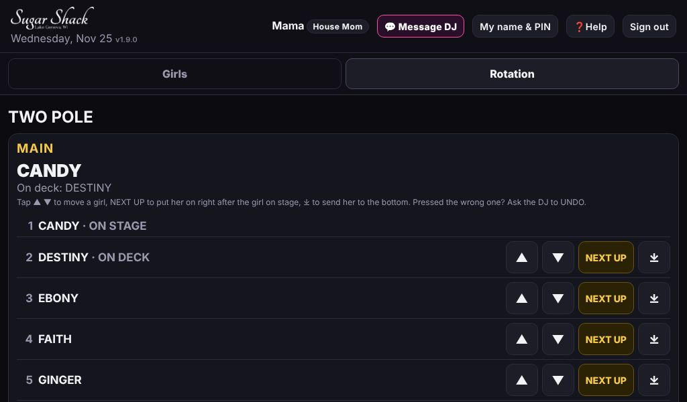

- **Tell the DJ something**: **💬 Message DJ**. See [Messages to the DJ](#messages-to-the-dj).
- **Your name and PIN**: **My name & PIN** at the top. To change your PIN you need your current one.

---

## For Dance Counters

You sign in as **Dance Counter**. The **Girls** tab is a list with one line per girl, in A–Z order, so the lines never move around.

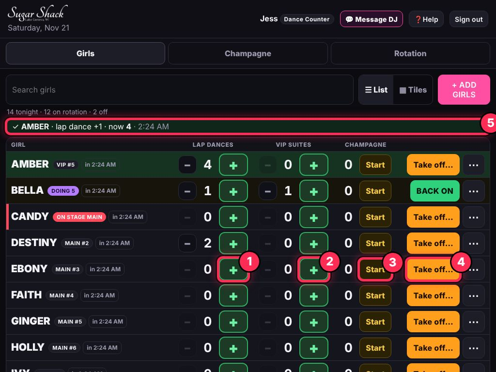

1. **+** under LAP DANCES: one more lap dance.
2. **+** under VIP SUITES: one more VIP suite. If she's on the rotation, it also takes her off as **DOING 5** (it's counted once).
3. **Start** under CHAMPAGNE: starts a champagne timer (see below). While it runs, the time left shows there instead.
4. **Take off…**: OFF, CHAMPAGNE, DOING 5 or WENT HOME. **BACK ON** puts her back.
5. The green line at the bottom says what you just did: **"✓ AMBER · lap dance +1 · now 4"**. Glance at it to make sure you hit the right girl.

**Counting fast and right:**

- The number changes the moment you tap, and her line lights up green.
- Tapped the wrong girl? Tap the small **−** on that girl's line: it takes one off (the line turns orange). **−** is grayed out at 0.
- Several people can count at the same time on different iPads. Everyone's counts add up and show on every iPad.
- Type in **Search girls** to find a girl fast.
- **⋯** on her line: arrival time, profile, notes, going home early, stop her champagne.
- **⚠ NO VIP** (or any ⚠) on her name is a note from the House Mom or a manager. **🏠 ASKED TO GO** means she asked to go home early. See [Notes and going home early](#notes-and-going-home-early).
- Like the big tiles better? Tap **▦ Tiles** at the top (and **☰ List** to go back). Each iPad remembers its choice.

**Other things you do:**

- **+ ADD GIRLS** and arrival times, the same as the House Mom.
- **Champagne**: see below.
- **💬 Message DJ**: see [Messages to the DJ](#messages-to-the-dj).

### Champagne (Dance Counters, Floor Hosts, Managers)

**Starting one**: tap **Start** on her line (or **+ START TIMER** on the Champagne tab).

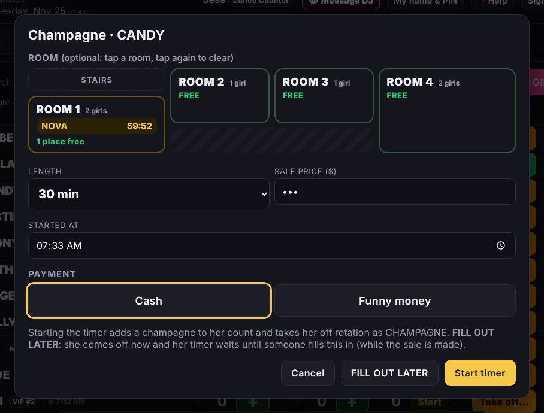

1. Pick the length: 30 minutes up to 6 hours, in half hours.
2. The price fills in by itself (the club's base price for that length). If she sold it for more, type what she sold it for. It can't be less.
3. If you're allowed to see the money, it shows underneath how it splits: **Club $… · Girl $…**. Otherwise you just see the price.
4. **Cash** or **Funny money**.
5. A room (optional). A full room can't be picked.
6. **Start timer**. She comes off the rotation as CHAMPAGNE.

**The Champagne tab** shows the rooms, every timer that's running, and tonight's list.

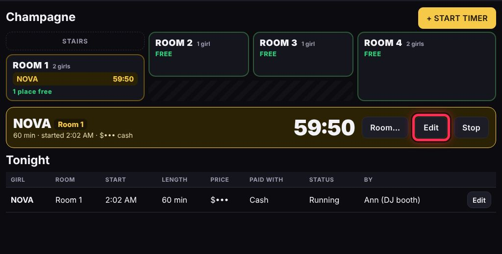

- **Room…**: move her to another room.
- **Edit**: fix the length, the price or cash / funny money. Changing the length keeps the start time.
- **Stop**: she's done early.
- When her time is up the timer flashes **TIME UP**. Starting someone new in her room stops her timer.

### Notes and going home early

**Notes** (restrictions) on a girl: **⋯** on her line, then **⚠ Notes**. Tap a ready-made one (**NO VIP**, **NO CHAMPAGNE**, **NO FEATURES**, **LEAVING EARLY**) or type your own, and pick **Tonight only** or **Always**. It shows as **⚠** on her name, on every iPad and the DJ screen, for people who can see the girls' profiles. **✕ Remove** takes one off.

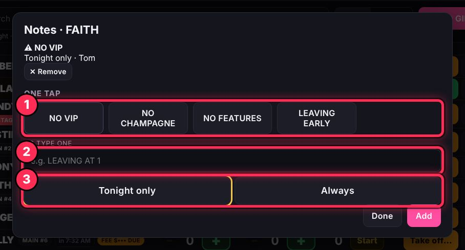

**She wants to go home early**: **⋯**, then **🏠 Wants to go home early**. Type why if you want, and press **Write it down**. This only writes it down (with the time); it doesn't take her off. **🏠 ASKED TO GO** shows on her name. If a manager says yes, take her off as **WENT HOME**. If she's staying, **⋯ → 🏠 Asked to go home → She's staying**.

---

## For Floor Hosts

You sign in as **Floor Host**. You have the same Girls list as the Dance Counters (see [For Dance Counters](#for-dance-counters)):

- Count **lap dances** and **VIP suites** with **+** and **−**.
- Start, fix and stop **champagne** (see [Champagne](#champagne-dance-counters-floor-hosts-managers)).
- **Take off…** / **BACK ON**.
- Move girls in the **MAIN** line on the **Rotation** tab (▲ ▼, NEXT UP, ⤓).
- **💬 Message DJ**.

You can't add girls, set arrival times or see the money.

---

## Messages to the DJ

Managers, the House Mom, Dance Counters and Floor Hosts can send the DJ a message from an iPad or iPhone.

1. Tap **💬 Message DJ**.
2. Tap a ready-made message (the Admin sets these up), or type your own and tap **Send**.

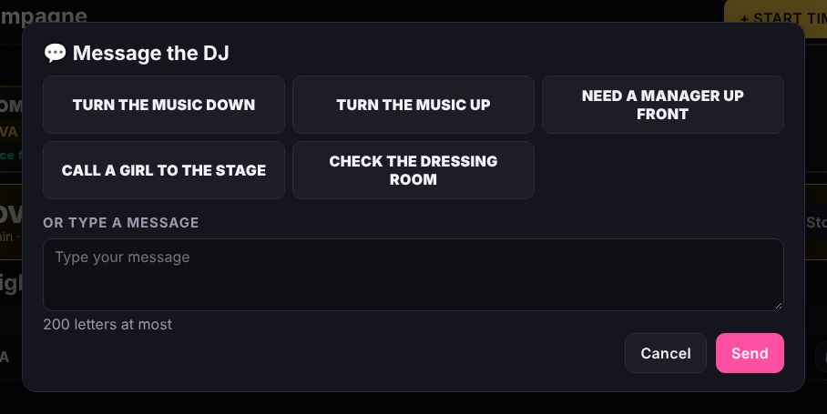

3. It flashes on the DJ screen until the DJ presses **GOT IT**. Your iPad shows **"✓ the DJ saw it"**.
4. If the DJ answers, the answer flashes on your iPad. Tap **OK**.

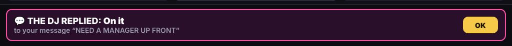

---

## For Managers

You can do everything the Dance Counters can, plus the money, the reports and the settings for the night.

### On the DJ computer

Press **🔒 Manager / Admin** (top right) and type your PIN. That opens the **Manager** and **History** tabs, the **Dance Counter ↗** window and deleting things. Press it again to lock it when you walk away.

### House fees

On an iPad: the **House Fees** tab.

1. **FILL IN ALL HOUSE FEES**: fills in a house fee for every girl here tonight in one go. New ones get tonight's base fee (and a late fee if the [late fee rules](#late-fee-rules) say so); ones not paid yet are brought up to date (lap dances, VIP suites, champagne fee). **Paid ones are left alone.**
2. **+ CALCULATE FEE**: pick the girl. The ones already worked out have a **✓** with their amount (paid or not); the rest are first. Picking one with a ✓ asks first, then works hers out again: **it updates her fee, it never adds a second one.** If the late fee rules say she was late, the late fee is already filled in with the reason; change it or clear it if you want.

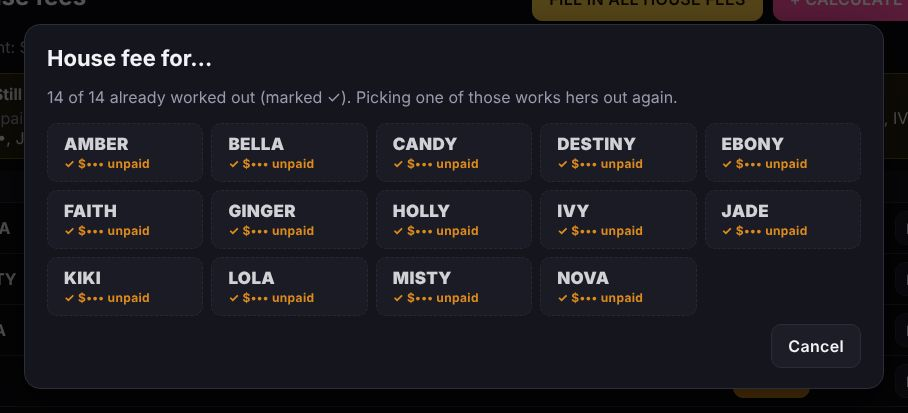

3. **💵 Still owes**: the box at the top lists who has no house fee yet and who hasn't paid. After last call a **💵 STILL OWES** bar shows on the iPads that see house fees, and starting a new night lists them first.

Mark a fee **PAID** when she pays. See [How the money works](#how-the-money-works).

### Late fee rules

**Manager** tab → **Late fee rules**: **+ Add rule**, tap the nights, the time and the late fee, then **Save rules**. A girl who comes in after that time on those nights gets that late fee filled in when her house fee is worked out. It's a starting point, not automatic: it's still your call, and you can change or clear it on her fee.

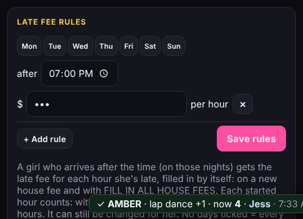

### Reports and history

**Money reports ask what goes on them.** On the DJ computer: **History** tab → pick the night → **Money report** (or **Download for Excel**). On an iPad: **Report** tab → **📄 Make a report…**.

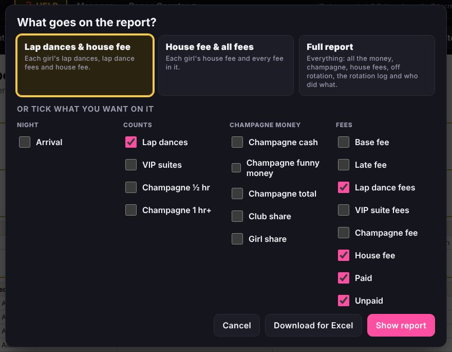

Pick one:

- **Lap dances & house fee**: each girl's lap dances, lap dance fees and house fee (paid and unpaid).
- **House fee & all fees**: each girl's house fee and every fee in it: base, late, lap dance, VIP suite and champagne fees, paid and unpaid.
- **Full report**: everything, like before: all the money, champagne, house fees, off rotation, the rotation log and who did what.

- **Who counted what**: every person's lap dance and VIP suite taps, girl by girl: how many they added, took back (−), and the total.

Or tick exactly what you want on it (arrival time, counts, champagne money, each fee). Then **Show report** or **Download for Excel**.

**Report templates**: ticked what you want? Press **☆ Save as template…** and give it a name (like "Friday payout"). Next time just tap it under **Saved templates**; the report has its name at the top. **✎** renames it, **✕** deletes it. Every manager sees the same templates.

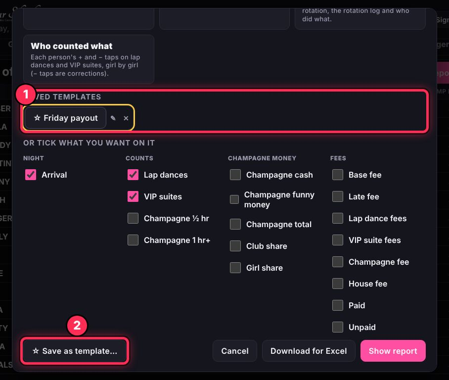

 Every report has a **TOTALS** line. To print, show it and press **Print** (on an iPad: Share → Print). Each computer and iPad remembers your last choice.

- **Report** tab on the iPad also shows tonight's numbers at a glance.
- Every night is also saved on the DJ computer in **Documents → Stage Rotation History** (the full report, and a file for Excel).

### Other manager things

- **Print dance sheet** (Manager tab): the paper Dancers Sheet in rotation order.
- **Champagne rooms** (Manager tab): the rooms and how many girls each holds.
- **Deleting** a champagne, a house fee or a girl from the roster.
- **New night**: a new night starts by itself in the morning (8:00 AM unless changed in the Manager tab).
- **The stages from an iPad**: if the Admin turns it on, managers get the poles, STOP and last call on the iPad's Rotation tab. It asks "Are you sure?" first, and **UNDO** is right there.
- **Updates**: when a new version is ready, a yellow **Update ready** banner shows on the DJ screen. Before the night starts, anyone at the DJ computer can install it. After START it needs an **Admin** PIN.

---

## For the Admin

The Admin is the owner. The **Admin** tab has the settings, prices and staff PINs. Until somebody has the Admin role, managers can change these too.

### First time on a new computer

1. Install Stage Rotation (**StageRotationSetup.exe**).
2. On the DJ screen open the **Admin** tab (no PIN is needed the first time).
3. **Staff PINs → + Add person**: add **yourself** with the **Admin** role first.
4. Add your managers and staff.
5. Check the prices (below) and the **iPads** card.

### Staff PINs and roles

Tick every job a person does. Someone with two jobs picks one when they sign in.

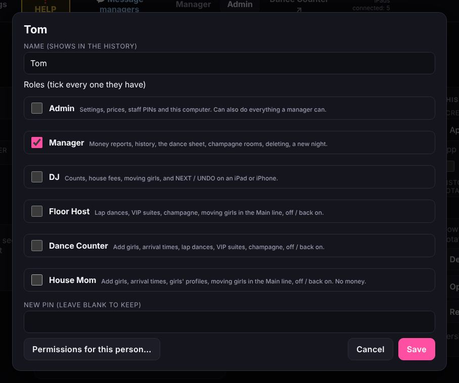

| Role | Can do |
|---|---|
| **Admin** | Settings, prices, staff PINs and this computer. Plus everything a manager can do. |
| **Manager** | Money reports (lap dances & house fee, all fees, or the full report), history, house fees, the dance sheet, champagne rooms, deleting, a new night. Plus everything a Dance Counter can do. |
| **DJ** | The DJ screen. On an iPad: counts, house fees, moving girls, NEXT and UNDO. |
| **Floor Host** | Lap dances, VIP suites, champagne, moving girls in the MAIN line, off / back on. No money. |
| **Dance Counter** | Add girls, arrival times, lap dances, VIP suites, champagne, off / back on, profiles. No house fees. |
| **House Mom** | Add girls, arrival times, profiles, moving girls in the MAIN line, off / back on. No money. |

That's how the jobs start out. You can change any of it (below).

A PIN is 4 to 8 digits and no two people can have the same one. After 5 wrong PINs in a row, that iPad has to wait.

### Permissions

**Admin** tab → **Permissions** → **Open permissions**: everything each job can see and do, page by page (Girls, Dances, Champagne, House fees, Rotation, Messages, Reports, Manager), one column per job. Tick or untick, then **Save permissions**. Every iPad picks it up by itself in a few seconds.

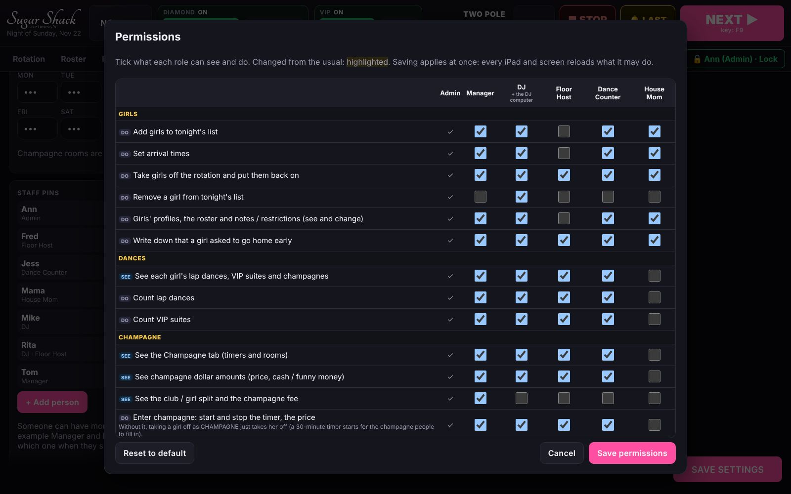

- The **Admin** always has everything.
- The **DJ** column is also what the DJ computer can do when nobody has typed a PIN.
- Things the DJ computer can't run without (NEXT, adding girls, off / back on) ask **"Are you sure?"** before you untick them for the DJ.
- **Reset to default** puts every job back the way it started.

**One person's exceptions**: **Staff PINs** → **Edit** next to the person → **Permissions for this person…**. For each item pick **As the role**, **Yes** or **No** for just that person (for example: no champagne for one Dance Counter). The staff list shows how many exceptions someone has.

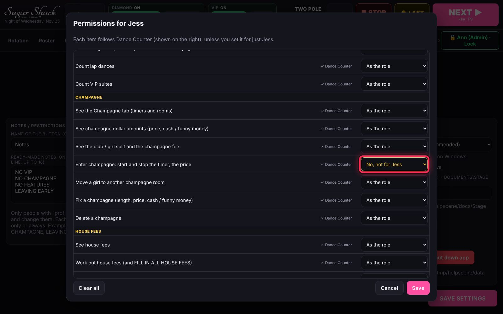

### Notes on girls

**Notes / restrictions on girls** (Admin tab): the name of the button on each girl (**Notes** unless you change it) and the ready-made notes, one per line. See [Notes and going home early](#notes-and-going-home-early).

### Prices

- **Per lap dance**, **per VIP suite**, **default late fee**.
- **Champagne**: the base price per half hour (the least a half hour can sell for), what the club takes per half hour, the champagne fee % and the usual length. The example under it shows what these numbers do.
- **Base house fee by night**: a different base fee for each day of the week.

### One-tap messages

The ready-made messages staff can send the DJ with one tap. Change them, add more (up to 12) or remove them.

### iPads

- **Let iPads on the club Wi-Fi connect** must be ticked.
- **DJ and Manager PINs can control the stages from an iPad**: tick it if managers or a DJ on an iPad should be able to change the poles, STOP and last call.
- The addresses to type on the iPads and iPhones are shown here. Give the DJ computer a fixed address in the router so they never change.

### The rest of the Admin tab

- **Club & stages**: club name and stage names.
- **Dressing-room screen**: which monitor and what it shows.
- **NEXT key**: click the box, then press the foot pedal (or a key) to use it as NEXT.
- **NEXT, set timer, breaks & last call**: also **the set timer counts songs** (the song count for the DJ, off unless you tick it) and how long a song is.
- **This computer**: start Stage Rotation with Windows.
- **Updates**: see [For Managers](#other-manager-things). Test (beta) versions need the beta PIN and are never installed by themselves; **Back to published version** undoes one.
- **Running backup** (on the DJ computer): pick a folder and press **Turn on**. Within about 20 seconds of any change, tonight, the roster, staff, settings and every past night are copied there. **Use OneDrive** fills in a OneDrive folder so the cloud always has the latest. Sign-ins are never copied. **Keep that OneDrive folder private** (it has the staff list). **Back up now** copies right away.

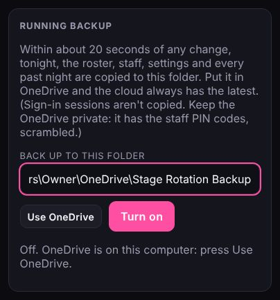

---

## How the money works

### Champagne

- It's sold in half hours: 30 minutes up to 6 hours.
- There's a **base price per half hour**. She can sell it for more, never less.
- For every half hour sold, the **club takes a set amount**. **Everything else is the girl's.** Cash and funny money work the same way.
- Her **champagne fee** is a set **percentage of all her champagne shares tonight**, rounded up to the next dollar. It fills itself into her house fee.
- You never have to work it out: the champagne form shows the split (**Club $… · Girl $…**) before you press Start timer, and the house fee fills in the champagne fee by itself.
- Ask a manager for the club's prices. The Admin sets them (Admin tab → **House fees & champagne**, which also shows a worked example).

### House fee

**House fee = base fee for tonight + late fee + champagne fee + (lap dances × lap dance price) + (VIP suites × VIP suite price)**

- The base fee depends on the day of the week.
- **FILL IN ALL HOUSE FEES** fills these in for everyone; a fee already marked **PAID** is never changed.
- A late fee comes from the [late fee rules](#late-fee-rules) or is typed in by hand. It can always be changed.

---

## Something's wrong

**I pressed the wrong thing.** On the DJ screen: **UNDO**. On an iPad: tap **−** for a count, **BACK ON** for a girl taken off; for anything else ask the DJ to UNDO.

**A red bar says "Lost connection" or "Reconnecting…".** Wait a few seconds; it fixes itself. Tap **Tap to reconnect**. On the DJ screen, if it stays, Stage Rotation may have closed: open it again from the desktop. Nothing is lost; it picks up exactly where it was.

**The dressing-room TV picture is covering the DJ screen.** Click it and press **Esc**, or move the mouse over it and press **✕ Close this screen**. To put it back on the TV: **Settings → Re-open dressing-room screen**.

**The foot pedal doesn't work.** Click once on the DJ screen and try again. If a red note at the top says the key is "used by another program", tell a manager. You can always click **NEXT ▶**.

**An iPad shows the wrong numbers or nothing changes.** Tap **Tap to reconnect** if the red bar shows. Still wrong? Close Safari (or the home-screen app) and open it again; you stay signed in.

**"Didn't save" on the Girls list.** The tap didn't reach the DJ computer (Wi-Fi). The number goes back to what's really saved. Tap again once the red bar is gone.

**Wrong PIN, and now it says wait.** After 5 wrong PINs that iPad waits 30 seconds (longer if it keeps happening).

**Still stuck?** Call the manager on duty. Don't restart the DJ computer in the middle of a song unless a manager says so.

---

*Stage Rotation 1.8.1 · This manual: [github.com/fivealarmtech/rotation-releases/blob/main/manual/README.md](https://github.com/fivealarmtech/rotation-releases/blob/main/manual/README.md)*
